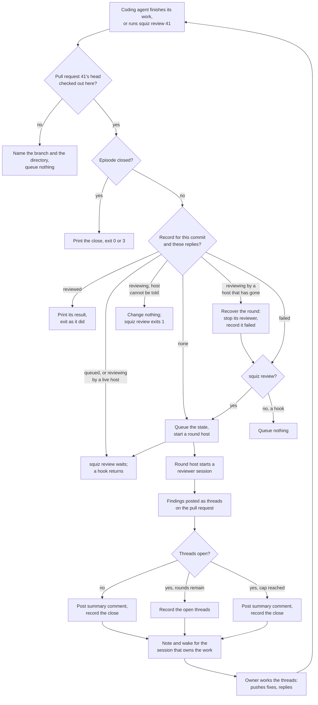
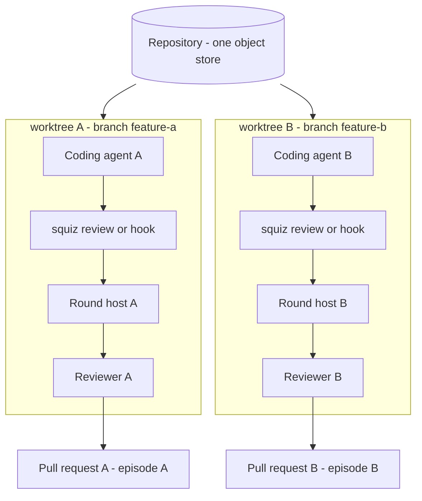

# Review Harness Specification: A Local Review Loop That Lives on the Pull Request

**Version:** 0.72 (draft)
**Status:** For review
**Owner:** TBD

---

## 1. Purpose

**Squiz is a local harness that automates code review between a coding agent and
a reviewing agent backed by different models, in a GitHub pull request.**

Agents write code faster than any person can read it, which breaks review in
two directions at once:

1. **It does not scale.** A person who reviews every change an agent produces is
   the constraint on the whole workflow.
2. **It becomes a rubber stamp.** A person who cannot keep up approves what they
   have skimmed, which is the same failure arriving quietly.

A reviewing agent reads the change and leaves its findings on the pull request,
and the two agents work through them there. A review starts when the coding agent
finishes its work, or when it runs one command. The reviewer runs as a session of
its own, and the coding agent reads the findings off the pull request. A person
opens a pull request that has already been reviewed.

## 2. Dependencies

Squiz runs on the developer's machine. Four things must be installed, and every
one of them is required.

| Role | Today | Needed for |
|---|---|---|
| Git repository | `git` | The review runs against a working tree and a merge base. The repository needs a remote for a pull request to exist against. |
| Runtime | Claude Code | Runs the coding agent, whose shell tool runs `squiz review`. Fires the `Stop` and `SubagentStop` hooks, which start a review. Wakes the session that owns the work when the review is done. Distributes the harness as a plugin. |
| Reviewer | `pi`, or the GitHub Copilot CLI where `reviewer` names it | The agent that reads the change and reports what is wrong with it. It must run a different model from the coding agent. Only the reviewer the configuration names has to be installed. |
| Forge | GitHub, through an authenticated `gh` | The pull request is where the review is conducted and recorded. |

A terminal multiplexer is optional. Where tmux or Herdr is running, each
reviewer runs in a pane of it, where a person can watch it. Where neither is,
the reviewer runs detached, and a log holds its progress.

### Verified against

The versions the design was checked against, and the command that re-checks
each.

| | Version | Re-check with |
|---|---|---|
| `git` | 2.50.1 | `git --version` |
| `gh` | 2.97.0, authenticated against github.com | `gh --version`, `gh auth status` |
| `pi` | 0.84.2 | `pi --version` |
| GitHub Copilot CLI | 1.0.91 | `copilot --version` |
| Claude Code | 2.1.261 | `claude --version` |

These behaviours were established rather than assumed:

- **`gh pr comment` and `gh pr review` take a body only.** Neither accepts a
  path or a line, so every inline comment goes through `gh api`. Re-check with
  `gh pr review --help`.
- **Claude Code runs a shell command under a timeout, and moves a command that
  reaches it to the background rather than stopping it.** The timeout is 120
  seconds where the agent passes none, and at most 600 where it passes one, read
  from `BASH_DEFAULT_TIMEOUT_MS` and `BASH_MAX_TIMEOUT_MS`. The agent is told the
  command moved, with the file its output goes to. Where background tasks are
  disabled the command is stopped instead, and a command a foreground subagent
  moved stops when that subagent's run ends. Documented, in Claude Code's tools
  reference under the Bash tool.
- **A foreground subagent often ends its run while its moved command is still
  running, and the command is stopped with it.** The runtime tells the subagent
  not to end its turn; three of five foreground subagents ended it anyway.
  Background subagents waited. Measured against 2.1.288.
- **A command stopped from outside gets `SIGTERM`, and so does every process
  under it, in the same instant**, including one started in a session of its
  own. `SIGKILL` follows one to two seconds later for whatever ignored it.
  Moving a command to the background sends nothing. Measured against 2.1.288.
- **Claude Code fails a subagent that makes no progress for 600 seconds, and a
  subagent waiting on a shell command is making progress.** A hook that holds a
  subagent is not. The threshold is read from
  `CLAUDE_ASYNC_AGENT_STALL_TIMEOUT_MS`. Measured against 2.1.270 and 2.1.288.
- **A long command output reaches the agent shortened, in a way that depends on
  the shell call's exit status.** Measured against 2.1.289:
  - A call that exits non-zero is cut to a head-and-tail excerpt of about 10,000
    characters, with no path to the rest. Over about 30,000 characters it is
    first cut to 30,000, so its real end is lost as well as its middle.
  - A call that exits 0 with a long output is saved to a file, and the agent is
    shown a preview of about 2 KB that names the file.
  - A coding agent that runs `squiz review 41; echo "EXIT=$?"` makes the call
    exit 0, so its output is never cut. Most subagents ran it that way.
- **A process outlives Claude Code stopping a command or a hook only if it leaves
  both the command's process tree and its process group.** A double fork with
  `setsid` between the forks does. A plain `&`, `setsid` alone,
  `nohup … & disown` and `( nohup … & )` do not. A tmux window, a Herdr pane and
  an agent `herdr agent start` started all outlive it as well, because the
  multiplexer's server is their parent, and so does a tmux server the call itself
  started. Measured against 2.1.288 on macOS.
- **An `asyncRewake` hook's exit 2 and a post to the session's
  `CLAUDE_CODE_MESSAGING_SOCKET` each start a turn in an idle interactive
  session**, ten minutes after its turn ended as well as one. The runtime enforces
  an `asyncRewake` hook's `timeout`, and a hook stopped at it wakes nothing. Every
  socket post reaches the agent as "Another Claude session sent a message".
  Measured against 2.1.288.
- **A `SubagentStop` payload's `session_id` is the session that dispatched the
  subagent**, and its `agent_id` is the subagent's own. Measured against 2.1.261.

### GitHub access

Permission to post comments is not enough on its own. The harness must be able
to do all of the following:

- Read a pull request: its diff, its description, and its base and head refs
- List the existing review threads and whether each one is resolved
- Create a review comment anchored to a file and a line
- Create a review comment on a file as a whole, carrying no line
- Reply inside an existing review comment thread
- Resolve a review thread, and re-open one
- Post an issue-level comment on the pull request, for the summary and for a
  round that failed

Resolving and re-opening a review thread is available only through GitHub's
GraphQL API. REST has no equivalent, so those two operations go through GraphQL.

### Identity

Every comment is posted with the credentials `gh` holds, so all of them appear
under the account that authenticated it. The reviewer, the coding agent and the
harness share one GitHub identity.

Each comment names its own author at the start of its first line, inside that
line's bold span. What follows the marker differs from comment to comment, so
the marker is the opening of the span rather than the whole of it.

| Written by | Begins |
|---|---|
| The reviewer | `**Squiz reviewer · ` |
| The coding agent | `**Squiz coding agent` |
| The harness, at close | `**Squiz review — ` |
| The harness, when a round fails | `**Squiz review failed — ` |

A comment without one of those markers was written by a person.

`**Squiz review` is itself a prefix of `**Squiz reviewer`, so the character
after the name is what separates the summary, the failure comment and a review
comment. A test for the summary that stops at the name matches every finding the
reviewer posted, and every failure.

## 3. The loop

The loop runs the review from end to end. A coding agent finishes its work on a
pull request, or runs `squiz review <number>`, and a round starts: a reviewer
reads the change in a session of its own, and its findings go onto the pull
request as threads. The session that owns the work is told the result. It works
the threads, replies and pushes, and the next round starts, until nothing is
open or the round cap is reached.

**Every trigger asks for the same review.** `squiz review <number>`, the Claude
Code hooks, a coordinator and a CI job are each a trigger. A trigger queues the
pull request's state for review and makes sure a round host is running, and does
nothing else. The round host runs the round, outside every trigger's process.

**Nothing has to reach into the coding agent's session for the loop to close.**
The pull request holds the review, and `squiz review` prints it, so any coding
agent that can run a shell command can be reviewed. Where squiz knows the
session that owns the work, it also tells that session, as The report sets out
below.

### Terminology

| Term | What it is |
|---|---|
| **Round** | One review of one state of a pull request, its head commit and the replies on the reviewer's threads: gate, review, post, decide. A round either leaves threads open for the coding agent, whose next push or reply starts the next round, or ends the episode. |
| **Episode** | Every round belonging to one pull request in one worktree. The round cap, the local state file and the summary comment are all per-episode; the review itself is per-round. |

An episode is **live** from its first round until it closes, and its reviewer is
reviewing or its coding agent is working on what the review said. It closes for
one of three reasons: nothing is left open for another round to work, the round
cap is spent, or a round reached the token bound. A round that failed closes
nothing — it posts a failure comment under § 7, and the episode stays live. A new
commit or reply, or a run of `squiz review`, retries it.

A live episode is one whose close has not been recorded. Nothing else makes an
episode live or over: not whether a round is running at this instant, because
between two rounds the coding agent is working and no round exists, and not how
long ago anything happened.

### The state file

**An episode is keyed by the number of its pull request.** Its state lives in
`.squiz/<number>/` inside the worktree. The state file holds the round count, the
cost of each round, what the episode spent on attempts that were no round,
whether the episode has reported its close and what was open at that close, and
what its rounds' comparisons established. The directory also holds:

- `rounds/<k>/`, for each round: `prompt.md`, the task prompt the reviewer is
  handed, the report file the reviewer reports into, the reviewer's session,
  `resume.txt`, the command that resumes that session, and `tree/`, the
  snapshot the reviewer reads while the round runs.
- `notes/`, the notes for the sessions that own the work, under The report.
- `host.log`, the round host's output.
- `state.lock`, held while the state file is changed.
- The reviewer's scratch space.

**Every change to the state file is made under `state.lock`.** A writer takes the
lock, reads the file, changes it, writes it, and releases the lock. A trigger
queueing a state and a round host writing its reviewing record therefore cannot
drop each other's record. The lock is held for one update and never across a
review, and it is a different file from `host.lock`. It names its holder's pid
and start time. A lock whose holder has gone is taken over. A writer that finds
the lock held by a live process, or by one that cannot be told running or gone,
waits up to a deadline of its own and never breaks the lock. A wait that runs out
is a state file that cannot be written (§ 7). Readers take no lock, because every
write replaces the file whole.

**The state file also holds one record for each state of the pull request the
episode has reviewed.** A state is two things, read when a trigger starts:

- **The head commit**, as GitHub reports it for the pull request.
- **The latest activity on the reviewer's threads.** Activity is a reply from
  anyone other than the reviewer, on a thread the reviewer opened: a comment after
  the first in that thread, carrying no `**Squiz reviewer · ` marker. The coding
  agent's replies are activity, and so is a person's. A thread a person opened
  holds no activity, whatever is said on it. The latest activity is the GitHub
  identifier of the newest such reply on the pull request, or none. An edited
  reply keeps its identifier and changes nothing. A deleted one can change which
  reply is newest, and that is a change like any other.

A new commit or a new reply is a new state. Either one means the review on record
no longer covers what the pull request now says.

Each record is in one of five states:

| State | What it records |
|---|---|
| Queued | A trigger asked for a review of this state, and no round has started it yet. |
| Reviewing | The round host running the round, and when that process started. A pid alone is reused, so the start time is what tells the round that holds it now from one that held it before. Also the round's number `k`, from the moment the round starts. Once the reviewer starts, also the reviewer's session: its backend, its pane or window where it has one, its pid and start time, the moment its time bound runs out, and its snapshot. |
| Reviewed | The result the round reached: its exit status, and the threads it left open. A round that left nothing open while a later state was queued behind it reached no close, so it records the result *reviewed clean, episode open*, with no exit status. Also the round's number `k`, which names its directory `rounds/<k>/` and so its `resume.txt`, when the round started and ended, and the reviewer's backend and pane or window. `squiz status` prints the round's times, and labels its Session from the backend and `k` (§ 6). |
| Failed | The reason the round failed, and whether its owner has been sent a note about it. Also the round's number `k` and when the round started and ended, where a round started, and the reviewer's backend and pane or window, where a reviewer started. |
| Not reviewed | The episode closed before a round took this state, or a later commit or reply superseded it before its round started, and why. |

A record also names the session that owns the work, where a trigger knew it:
the session's identifier, the subagent that did the work where one did, and the
session's messaging socket where the hook found one. The Claude Code hooks
record it, and `squiz review` records none.

A record also carries the Herdr workspace the trigger ran in, from the
`HERDR_WORKSPACE_ID` in its environment, where it has one. Herdr sets it in every
pane it manages, so a hook or a `squiz review` run from the coding agent's pane
finds the coding agent's workspace. The reviewer's tab opens there (§ 4 The
reviewer session). A workspace id is a `w` and a number, such as `w2`. A value of any other shape
is not recorded, and the tab opens in the focused workspace.

**A trigger reads the record for the pull request's state before it queues
anything.** It has looked up the pull request and listed its threads by then,
because the state is read from them.

- **No record:** the trigger queues the state, and starts a round host where
  none is running.
- **Failed:** a hook queues nothing. `squiz review` queues the state again,
  because running the command is the request to retry it.
- **Reviewing**, by a round host that has gone: the trigger recovers the round, as
  The round host sets out, which records it failed. It then does what it does for
  a failed state.
- **Queued:** the trigger queues nothing, and starts a round host where none is
  running.
- **Reviewing**, by a round host that is running: the trigger queues nothing.
- **Reviewing**, by a round host no one can tell running or gone: the trigger
  recovers nothing, queues nothing and starts nothing, because recovering a round
  whose host may be alive would stop a live reviewer and remove its snapshot.
  `squiz review` exits 1 naming the host it could not check, and a hook returns.
  The next trigger checks again.
- **Reviewed, or not reviewed:** the trigger queues nothing. `squiz review`
  returns that result, with the threads read from the pull request as they stand
  now.

`squiz review` then waits, as § 7 sets out, and the hooks return at once.

**A failed state is retried only on a fresh request.** A new commit or a new
reply is a new state, with no record, and is queued like any other. The same
state is retried only by someone running `squiz review`. A hook firing on a
state that failed queues nothing, so a turn the coding agent spent reading a
failure note does not bring the failure back. Failures that spend no round, such
as a reviewer that will not start or a `gh` that cannot run, follow the same
rule.

**No failure starts a cycle.** A failed state gets one note, however many times
it fails (The report). A retry by `squiz review` that fails again posts its
failure comment, returns exit 1 to the run that asked for it, and writes no
second note. So every attempt after the first needs someone to run the command,
and a run that gets exit 1 is told not to run it again (§ 9).

**Every trigger therefore gets one review per state.** A second trigger for a state
already queued or under review finds it and queues nothing, so two firings for one
commit and the same replies post one set of threads and at most one summary. One
episode runs one round at a time. A state queued while a round of an older one runs
is reviewed next.

**A state accepted into the queue is never dropped.** It is reviewed, or it is
given a result of its own. Say state A is under review and state B, a later
commit, is queued behind it:

| A's round ends with | What happens to B |
|---|---|
| Threads open, rounds remaining | B is reviewed next, as usual. |
| Nothing open, rounds remaining | The episode does not close. A is recorded as *reviewed clean, episode open*: no exit status, no summary, and no note for its owner. B is reviewed next, and the episode closes from the last round with nothing queued behind it. A run of `squiz review` waiting on A goes on waiting, for the state the queue ends on, and returns that state's result: 0 or 3 with the close, or 2 where B left threads open. It exits 4 where its wait runs out first. |
| The round cap reached, or the token bound | The episode closes, as it must, and posts its summary. Its Notes name the cap or the bound and each state left not reviewed, whether A left threads open or nothing. B is recorded as not reviewed, with the reason. A run of `squiz review` waiting on B is handed the close, exit 0 or 3, with a line saying why B was not reviewed, and B's owner gets a note saying the same. |

The line comes right after the heading of the close the run is handed:

```
Full output: /work/squiz/.squiz/41/review.txt
Squiz reviewed PR #41 at 3f9c2e0: round 3 of 3, no new findings.
Squiz did not review PR #41 at 8d21a4f: the episode closed at the round cap, after reviewing 3f9c2e0.
```

Where the token bound closed the episode, its reason reads "the episode closed at
the token bound, after reviewing 3f9c2e0".

**A round reviews the pull request's newest state, and only that.** When its
round starts, the round host checks that the state it took is still the pull
request's: the same head commit and the same latest activity. A state the pull
request has moved past is superseded. No review runs for it, nothing is posted,
and it is recorded not reviewed with a reason naming the state that superseded
it, in the form § 5's Notes use:

```
superseded by 8d21a4f
superseded by 3f9c2e0 with different replies
```

The newer state is queued by the trigger that read it, and reviewed in its turn.
The state a round reviews is the one its result is recorded against: the reviewer
reads a snapshot of that state's head commit (§ 4 The snapshot).

The record also holds the head commit and latest activity of the state that
superseded it, because the reason names that state only by its short commit, and
other states can share a commit.

A run of `squiz review` whose own state was superseded goes on waiting, for the
state with that head and activity, and returns that state's result. Where that
state was superseded in turn, the run follows it to the next. It exits 4 where
its wait runs out first, or where no record for that state has been written yet,
as § 6 shows.

**A round decides its close and records it in one step.** It reads the queue
under `state.lock`, decides from it as the table above sets out, and writes the
close in that same update, before it posts the summary. A trigger that comes
after the close finds it and queues nothing, so no state queued while the
summary is posted is stopped by a close it arrived before.

**A state left not reviewed is named by its short head commit, and by its
replies where an earlier state has the same commit.** The earlier states are the
one the closing round reviewed and those queued ahead of it. A state with the head
of an earlier state differs from it only in its replies: a reply was added or
deleted, and the record cannot say which. Such a state is named "with different
replies". A state whose head two earlier states have is named "with different
replies a second time", one with three "with different replies a third time", and
so on. Where B has A's commit and different replies, the line reads:

```
Squiz did not review PR #41 at 3f9c2e0 with different replies: the episode closed at the round cap, after reviewing 3f9c2e0.
```

The summary's Notes name each state the same way (§ 5 What the comment carries).

**A reply is ruled on even where no commit follows it.** A coding agent that
disputes a finding and pushes nothing asks for a review again on a new state, and
the round reads its reply and rules on the thread: `withdrawn` where the argument
holds, `open` where it does not. A reply posted while a round runs is not in that
round's state, so the next run reviews again.

**Every round counts against the round cap, whatever started it.** A round that a
reply started is a round, exactly as one a commit started. A coding agent that
answers every finding with a dispute spends the cap doing so, and the episode
closes at the cap with the disputes for a person. A run that returns a recorded
result is no round and spends nothing.

**A closed episode stays closed in its worktree.** A run on a state the episode
never reviewed starts no round once the close is recorded; it prints the close,
as § 6 shows. A second episode on the same pull request starts in another
worktree on the same branch, which holds no state for it.

What the rounds' comparisons established is three lists: the tracked paths any
round found changed, each move of `HEAD` any round found, and why a round could
take no comparison. The summary comment's Notes are composed from all three.

Each list holds an entry once, however many rounds gave it, and stops at
sixty-four entries. One round can reach that on its own, because one reading can
name more than sixty-four changed paths. An attempt that is no round spends none of
the round cap and can fail the same way on every run, so nothing bounds how many
times one episode adds to these lists either.

**A full list keeps the entries recorded first.** A later round adds to a list with
room left and adds nothing to a full one, so what an earlier round established is in
the comment the closing round posts.

The state file is gitignored with the rest of `.squiz/`, so the comparison of
tracked files under Confinement never reads it as a change.

### End-to-end workflow



### A round, step by step

1. **Gate on the pull request.** The trigger looks up pull request `<number>`
   and checks that its head branch is the branch checked out in the directory it
   was run in, and the round host checks again when the round starts, together
   with whether a later state has superseded the one it took (The state file).
   If the pull request is not open, or that directory has another branch or a
   detached HEAD, no review runs and nothing is posted. `squiz review` exits 1, and stderr names
   what it found:

   ```
   squiz: no review ran: PR #41's head is "feature-a", and "/work/squiz" has "main" checked out
   ```
2. **Gate on the episode and the commit.** The trigger reads the episode's state
   file. An episode that has reported its close is over: `squiz review` prints the
   close and exits as the close did, and no reviewer runs. The round cap and the
   token bound are not consulted, because an episode that is over stays over
   whatever a bound would now allow. Otherwise the trigger lists the threads, and
   the record for the pull request's state decides, as The state file sets out,
   whether the state is queued.
3. **Run the reviewer.** The round host starts the reviewer as a session of its
   own (§ 4), hands it the pull request for scope and intent together with
   the threads the reviewer itself opened on it, and lets it read directly its
   snapshot of the head commit of the state it took: files the diff did not touch, callers, and git history. At
   depth `deep` it also runs the tests. The reviewer never edits the code it is
   reviewing.
4. **Post the findings, and act on the verdicts.** Each new finding opens a new
   review comment thread, anchored to a file and a line or to a file as a whole.
   Each verdict the reviewer returned is applied to the thread it names: `fixed`
   and `withdrawn` close the thread, `open` re-opens it or leaves it open.
5. **Record the open threads, or close.** If threads of this review are still
   open and the round cap has not been reached, the round records the result. A
   run of `squiz review` waiting on it prints the open threads and exits 2, and the
   round tells the session that owns the work (The report). A thread a person opened is counted by neither the arithmetic
   nor the output, so it never keeps the loop going and an episode ends with one
   still open. § 6 shows what is printed.

   Where the round's comparison found that `HEAD` moved in the reviewer's
   snapshot while the reviewer ran, the output ends with a paragraph naming both
   ends of the move, and Notes names it under § 5. A round that failed reports its
   move in its failure comment, under § 7.
6. **Close the episode.** Otherwise, and where nothing is queued behind this
   round or the cap or the token bound is reached, the round records the close in
   the episode's state, in the same update that read the queue, and then posts
   one summary comment on the pull request. A state still queued is handled as
   the table above sets out. A run of
   `squiz review` exits 0 where nothing of this review is open, and 3 where the
   round cap or the token bound closed it with threads still open, which it
   prints. What remains open is what
   the summary reports and what a person then looks at.

Where threads are open, the coding agent works them before it asks for another
review. It replies on a thread to say what it changed, to disagree, or
to ask a question. It does not close threads. A thread closes when the reviewer's
verdict closes it, so a closed thread means the reviewer read the code as it now
stands and accepted it.

### The round cap

The cap defaults to 3 and is settable from 1 to 8. A cap of R hands open threads
back to the coding agent at most R−1 times, because round R closes the episode
whatever is still open. A cap of 1 reviews once and closes.

### What starts a round

**A round starts when a trigger queues a state and the round host takes it.**
There are two kinds of trigger:

- **`squiz review <number>`**, which the coding agent runs once it has opened its
  pull request and again after each push that works the threads. A coordinator or
  a CI job may run it as well, from a checkout of the pull request's branch. It
  waits for the review, and prints the result.
- **The Claude Code hooks**, on `Stop` and `SubagentStop`, which queue the state
  and return at once.

**The instruction to run `squiz review` reaches the coding agent two ways.**

- **In Claude Code, a skill the plugin ships.** Its description has the coding
  agent load it when it opens or updates a pull request. A Claude Code project
  needs nothing in its own files for this.
- **For any other agent, a section of the host project's `AGENTS.md`**, which
  `squiz init` adds.

§ 9 gives the text of both. Nothing forces an agent to follow either. Claude Code
loads a skill when its description matches what the agent is doing, and does not
promise to. In Claude Code the hooks start a review whether the agent follows it
or not. An agent in a runtime with no hook that never runs the command leaves a
pull request no round has read, which carries no comment with any of § 2
Identity's markers.

**The round runs in the round host, not in the caller.** `squiz review` waits
inside the caller's tool call, but stopping that call stops only the wait. A
coding agent that ended its turn may be editing its worktree while a round runs.
The reviewer never reads that worktree: it reads a snapshot of the head commit,
as The snapshot under § 4 sets out, so neither sees the other's changes.

### The round host

**The round host runs the rounds of one episode, one at a time, outside every
trigger's process.** It is `squiz host <number>`. A trigger that queues a state
starts one where none is running, by a double fork with `setsid` between the
forks, with its standard input on `/dev/null` and its output in
`.squiz/<number>/host.log`. That is what lets it outlive the shell call or hook
that started it (§ 2).

It takes the oldest queued state, writes the reviewing record naming itself, and
runs the round as the steps above set out. It exits when nothing is left queued,
and when the worktree it serves is gone.

**One round host runs per episode.** It holds `.squiz/<number>/host.lock`, which
names its pid and start time. A host that finds the lock held by a live process
exits at once, so two triggers that each start one leave one running.

**A host that died is found by its pid and start time.** A queued state with no
live host is one no host will take, and the next trigger starts a host for it. A
reviewing record whose host has gone is a killed round, and its reviewer may
still be running: the host and the reviewer are separate processes, and a
reviewer in a pane is not the host's child.

**Recovery stops the orphaned reviewer before anything replaces it.** Every
trigger, and every round host as it starts, recovers each killed round it finds:

1. It reads the reviewer's session from the reviewing record: its backend, its
   pane or window, its pid and start time.
2. Where that reviewer is still running, it stops it as a round host stops a
   reviewer at its bound: the reviewer's process group, then the groups its shells
   recorded, then the pane. It does so whether or not the reviewer's time bound
   has passed, so an orphan past its bound is always stopped by the first
   recovery to find it.
3. It confirms that the reviewer and every recorded group are gone, by pid and
   start time and by asking the backend for the pane.
4. Only then does it remove the snapshot and record the round as failed, with
   the reason "the round host died". No failure comment is posted.

A recovery that cannot confirm the reviewer is gone leaves the snapshot and the
record as they are, and starts nothing for that state. `squiz review` exits 1
naming the process it could not stop, and the next recovery tries again.

**Nothing stops an orphan before a recovery runs.** While no host is alive, the
reviewer's time bound is enforced when the next trigger or `squiz review` runs,
and not before.

### The Claude Code hooks

**Squiz registers `squiz hook` on Claude Code's `Stop` and `SubagentStop`.**
`Stop` fires when a regular session's turn ends, and `SubagentStop` when a
subagent's does. Each firing resolves the pull request whose head is the branch
checked out in its working directory, records the session that owns the work,
queues the state as The state file sets out, and returns. It never runs a round
and never blocks the agent: it exits 0 whatever it found. Where it finds no pull
request it writes the line under step 1 naming the branch and the directory.

```json
"Stop": [
  { "hooks": [ { "type": "command", "command": "${CLAUDE_PLUGIN_ROOT}/bin/squiz hook", "asyncRewake": true, "timeout": 86400 } ] }
],
"SubagentStop": [
  { "hooks": [ { "type": "command", "command": "${CLAUDE_PLUGIN_ROOT}/bin/squiz hook" } ] }
]
```

| Event | The owner of the work it records |
|---|---|
| `Stop` | The session itself, from the payload's `session_id`, and its `CLAUDE_CODE_MESSAGING_SOCKET` where the hook's environment carries one |
| `SubagentStop` | The session that dispatched the subagent, from the payload's `session_id`, and its `CLAUDE_CODE_MESSAGING_SOCKET` where the hook's environment carries one; and the subagent, from its `agent_id` |

A subagent runs inside its parent's process and has no socket of its own, so the
socket in a `SubagentStop` hook's environment is the parent's.

The `Stop` registration runs in the background, so the session does not wait on
it. After it has queued, it stays to deliver a note, as The report sets out. The
`SubagentStop` hook returns as soon as it has queued.

**Nothing the runtime does to a hook bounds a review.** The hook only queues, so
neither the hook's timeout, nor the stall threshold, nor the hand-back that ends a
subagent in auto mode reaches the round.

A turn ending is not work being done. The hook fires on every turn, including one
that ended on a question, and queues only a state that needs a review, so a turn
that pushed nothing starts nothing. A firing for a subagent the session did not
dispatch, for a state already queued or reviewed, queues nothing.

**A `SubagentStop` firing whose `agent_type` is empty is no subagent's work.** In
an interactive session, Claude Code fires two or three of them after a turn ends,
each with a new `agent_id`, the parent's `session_id`, and no transcript. The hook
does nothing for one: it resolves nothing, records no owner and queues nothing.

The hook's shell does not have the plugin's `bin/` on its `PATH`, so the
registration names the binary through `${CLAUDE_PLUGIN_ROOT}`.

### The report

**The result goes to the session that owns the work and is still alive.** For a
regular session's work that is the session itself. For a subagent's work it is
the session that dispatched it: the subagent has ended, and in auto mode it has
handed back, so nothing reaches it.

When a round records its result, the round host writes a note for the owner
recorded on the state, in `.squiz/<number>/notes/<session id>/`, one file per
note, written under a temporary name and renamed into place:

```
to=60517e1f-e1dc-49b1-8e39-6fcbe686f3fb
pr=41
head=3f9c2e07b1d4a8c6e5f0923b7a1d6c4e8b2f5a90
subagent=a402ef8f56c1b2ed1
text=Squiz reviewed PR #41 at 3f9c2e0, the work of subagent a402ef8f56c1b2ed1: 2 threads are open. Run `squiz review 41` to read them.
```

The note points, and carries no finding. `subagent` is there only where a
subagent did the work. For a round that failed, the text gives the reason, names
`squiz status`, and says that a new commit, or running `squiz review` once,
retries it. A failed state gets one note, however many times it fails, and a
state not reviewed gets one saying why. A state no hook recorded an owner for gets
no note.

**Then it wakes the owner, one of two ways.** Whichever delivers a note moves it
into `delivered/` beside it, so the other does not deliver it again.

- **The messaging socket.** Where the hook recorded the owner's
  `CLAUDE_CODE_MESSAGING_SOCKET`, the round host posts the text to it, and an idle
  session starts a turn with it.
- **The `asyncRewake` waiter.** The `Stop` hook, once it has queued, waits while
  any state its session owns is queued or under review. When a note for its
  session arrives it writes the text to stderr and exits 2, which starts a turn.
  It delivers any note already waiting for its session first. Claude Code does
  not deduplicate background hooks, so a session that ends three turns has three
  waiters, and a waiter whose session has ended a later turn exits 0 without
  delivering anything. Only the newest delivers.

**A subagent's parent decides what follows.** It reads the threads with
`squiz review`, and sends the same subagent back to work them, dispatches
another, or works them itself. Squiz does not choose.

**A note no wake reached stays where it was written.** The owner learns the
result by running `squiz review` or `squiz status`, and the pull request holds it
in any case.

### Not in the first version

- **Delivering notes when a session starts.** A note waiting for a session that
  was closed is delivered only by its next `Stop` waiter, or read by pull.
- **Acknowledgement and retry rules.** A note is delivered at most once, and
  nothing retries one a wake did not reach.
- **A two-way inbox.** The coding agent answers on the pull request, and never
  through a note.

### Parallel coding agents

Each coding agent that opens a pull request works in its own git worktree on its
own branch. A branch can be checked out in only one worktree at a time, so the two
go together.

**The command reviews the worktree it is run in.** It resolves the toplevel with
`git rev-parse --show-toplevel` from its own working directory, which is the
caller's. A coding agent working in a worktree by path runs the command from that
path, and that worktree is the one reviewed. The hook runs in the subagent's
working directory, which is fixed when the subagent is dispatched.

In this repository a Claude Code subagent that opens a pull request is dispatched
with `isolation: "worktree"`, and its first command switches to its own branch:

```bash
git switch -c <area>/<short-name> origin/main
```



The worktrees share one object store and nothing else. Each run of the command
resolves its own working directory, so one reviewer sees one coding agent's change
and posts to one pull request. One worktree, one branch, one pull request, one
episode.

**The harness does not remove a worktree.** The coding agent is still in it when
the command returns. Whatever created the worktree removes it, and a round host
whose worktree is gone exits. The episode's state
goes with the worktree, and nothing in it outlives the worktree, because the pull
request holds the findings.

**A reviewer's snapshot is its own, so a tree two episodes share reaches neither
comparison.** One tree holds two pull requests' episodes when its `HEAD` moved to
another branch while the first episode was live. Each keeps its state under its
own number, and each reviewer reads a snapshot that only it writes.

**Two coding agents on one branch in one tree share one episode, and nothing tells
them apart.** They spend one round cap between them. Nothing detects this.

